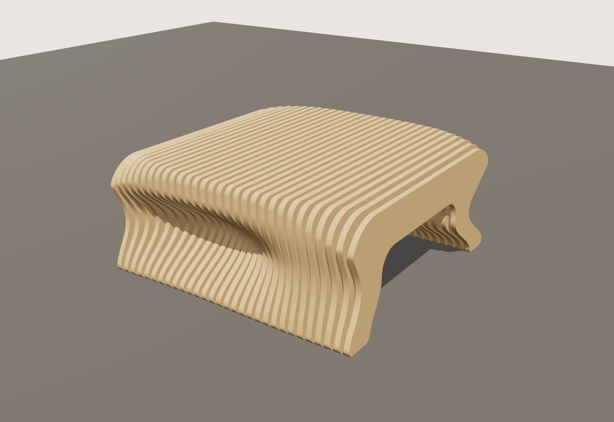
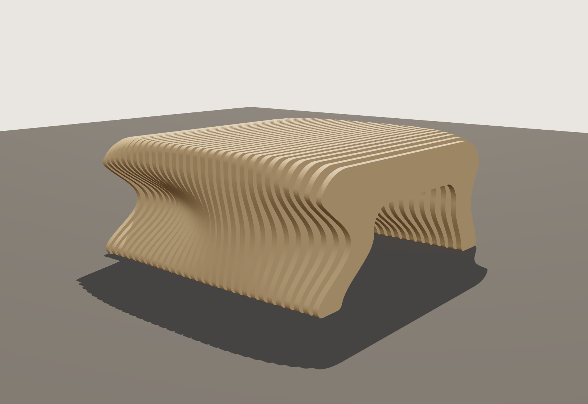

# Parametric slatted coffee table, 36" × 36"

A CNC-cut plywood coffee table in the style of sliced "parametric" furniture.
It is made of 30 plywood ribs on threaded rods. The top is flat. The legs bow
in and out from rib to rib, and the tunnel underneath shifts, so the sides
read as a wave.




| | |
|---|---|
| Size | 914.4 × 914.4 mm (36" × 36"), 406.4 mm (16") high |
| Ribs | 30 × 18 mm plywood, 12.9 mm gaps |
| Material | 6 sheets of 4 × 8 ft (1220 × 2440 mm) 18 mm Baltic birch |
| Hardware | 5 × M8 threaded rod (910 mm), 145 spacer tubes 16 OD × 12.9 mm, 10 nuts + washers |

## Files (`output/`)

| File | What it is |
|---|---|
| `coffee_table_sheet_01.dxf` … `_06.dxf` | Ribs nested on 4 × 8 sheets, ready for CAM |
| `coffee_table_all_ribs.dxf` | All 30 ribs in one file, laid out in a grid |
| `coffee_table_3d.stl` | 3D model of the assembled table |
| `coffee_table_drawing.dxf` / `.pdf` | Plan, front and side views with dimensions |
| `cut_list.csv` | Every rib with its size and sheet, plus hardware |

All files are in millimetres. DXF layers:

| Layer | Operation |
|---|---|
| `CUT_HOLES` | 8.5 mm rod holes, cut first |
| `POCKET_COUNTERBORE_10MM` | 22 mm counterbore, 10 mm deep (ribs 01 and 30 only) |
| `CUT_OUTSIDE` | Rib outline, profile cut outside the line, use tabs |
| `LABEL` | Rib number, engrave lightly or ignore |
| `SHEET` | 1220 × 2440 sheet boundary, reference only |

The smallest inside radius is 8 mm, so any cutter up to 1/4" (6.35 mm) works.

## Cutting notes

- **Measure your plywood first.** "18 mm" sheet is often 17.5–18.5 mm. Set
  `RIB_T` in `generate.py` to the real thickness and run it again. The gap
  between ribs is recalculated so the table stays exactly 36" deep.
- Every rib is drawn with the face that points toward rib 30 facing up.
  Rib 01 is mirrored so its counterbores land on its outside face. Keep the
  labels facing the same way when you stack them.

## Assembly

1. Sand the edges of each rib (a 3 mm roundover on the top edges looks good) and finish before assembly. Hardwax oil works well.
2. Cut the spacer tubes to the gap (12.9 mm, or the gap the script prints).
3. Lay rib 30 face down. Push the five rods through and fit a washer and nut in each counterbore.
4. Stack ribs 29 down to 01, with a spacer on every rod between each pair of ribs.
5. Fit the washers and nuts in rib 01's counterbores and tighten them evenly until the stack is firm. Check the top is flat as you go.
6. Trim the rods flush with the nuts. You can plug the counterbores with 22 mm wood plugs.
7. Put a felt pad under each rib foot.

The top is slatted. If small things will sit on it, use a 10 mm tempered glass top (914 × 914, rounded corners) on clear bumpers.

## Changing the design

All dimensions and the shape are set by the parameters at the top of
`generate.py`: size, rib count, how far the legs bow (`WAIST`), the tunnel
height, corner radii, rod size and sheet size. The script checks that every
rod hole has solid wood around it in every rib, and stops with an error if a
change breaks that.

```bash
pip install -r requirements.txt
python generate.py                     # rebuilds output/
cd render && npm install && node render.cjs   # optional: re-renders images/ (needs Playwright + Chromium)
```
